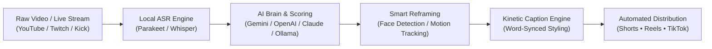

# ⚡ ExtremeCut

<p align="center">
  <b>The open-source, autonomous AI studio for transforming long-form videos & live streams into viral vertical shorts.</b>
</p>

<p align="center">
  
  
  
  
  
  
</p>

---

## 🌟 Overview

**ExtremeCut** is a self-hosted, full-stack video intelligence platform. Paste a URL from **YouTube**, **Twitch**, or **Kick** (or upload your own video file), and ExtremeCut automatically transcribes speech, detects high-retention moments with AI, tracks speaker faces for dynamic 9:16 vertical reframing, generates word-synced animated subtitles, and directly publishes to **YouTube Shorts**, **Instagram Reels**, and **TikTok**.

It also monitors creator live streams in real time, clipping viral moments while the broadcast is still live.

---

## 🚀 Key Highlights

- 🧠 **Autonomous Viral Moment Detection**: Understands context, punchlines, dramatic moments, and story hooks using top LLMs (Gemini, GPT-4o, Grok, Claude, Groq, or local Ollama).
- 🎙️ **Private, High-Speed On-Device Transcription**: Word-level timestamps powered locally via `sherpa-onnx` (Parakeet) or Whisper. Audio never leaves your hardware.
- 🎯 **Smart Face Tracking & Vertical Reframing**: Dynamically centers on active speakers and crops landscape video into 9:16 vertical shorts.
- 🎨 **Kinetic Subtitle Engine**: Word-by-word synchronized subtitles with animated accents in popular creator typography styles (Anton, Archivo Black, Poppins).
- 🔴 **Real-Time Live Stream Clipping**: Connects to active live streams with rolling memory buffers; clips highlights instantly based on transcript hooks, audio spikes, and chat velocity.
- 📲 **1-Click Multi-Platform Auto-Posting**: Built-in OAuth integration to schedule or instant-post to YouTube Shorts, Instagram Reels, and TikTok with daily pacing caps.
- ⚖️ **Fair-Share Queue & Hardware Guard**: Built-in adaptive scheduler monitors host CPU, RAM, and disk utilization, throttling safely to prevent server crashes under heavy workload.
- 👤 **Zero-Config Local Mode or Multi-User Cloud**: Runs seamlessly as a local desktop app with zero login required, or switch on multi-tenant authentication (`EXTREMECUT_ACCOUNTS=1`) for a hosted production SaaS with admin dashboards.

---

## 🏗️ Architecture & Pipeline



---

## 🤖 Bring-Your-Own-AI (BYOAI)

ExtremeCut gives you complete freedom: pay providers directly with zero markups or run completely free on your own local GPU:

| Provider | Supported Engine | Setup Location | Cost |
| :--- | :--- | :--- | :--- |
| **Google Gemini** | `gemini-2.5-flash`, `gemini-1.5-pro` | [Google AI Studio](https://aistudio.google.com/apikey) | Extremely fast & low cost |
| **OpenAI** | `gpt-4o-mini`, `gpt-4o` | [OpenAI Platform](https://platform.openai.com/api-keys) | Industry standard |
| **Grok (xAI)** | `grok-4` | [xAI Console](https://console.x.ai) | Real-time knowledge |
| **Groq** | `llama-3.3-70b-versatile` | [Groq Console](https://console.groq.com/keys) | Ultra-low latency |
| **Anthropic** | `claude-3-5-sonnet` | [Anthropic Console](https://console.anthropic.com) | Superior nuanced analysis |
| **OpenRouter** | Any OpenRouter model | [OpenRouter Keys](https://openrouter.ai/keys) | Unified gateway |
| **Ollama** | `llama3.1`, `mistral`, etc. | Localhost (`ollama run ...`) | **100% Free & Offline** |
| **None (Audio Only)**| Loudness & RMS energy triggers | No configuration needed | Built-in fallback |

---

## ⚡ Quick Start

### Prerequisites
- **Python 3.10+**
- **FFmpeg** installed and added to your system `PATH`

### 1. Clone & Install
```bash
git clone https://github.com/sohom-since-006/ExtremeCut.git
cd ExtremeCut
pip install -r requirements.txt
```

### 2. Download the Speech Recognition Model
Download the high-speed on-device speech model (~480 MB):
```bash
python -m studio.fetch_model
```

### 3. Launch the Server
```bash
python -m studio.server
```

Open **[http://127.0.0.1:8765](http://127.0.0.1:8765)** in your browser. There is no sign-in required on local setups—it launches directly into the studio dashboard. Head to **Settings → AI** to plug in your API key and choose your model.

---

## 🐳 Docker Deployment

ExtremeCut includes a production-ready container stack comprising the core application, PostgreSQL, and Caddy for automatic SSL:

```bash
# 1. Copy environment template
cp .env.example .env

# 2. Configure domain and database password in .env
# EXTREMECUT_DOMAIN=clips.yourdomain.com
# POSTGRES_PASSWORD=your_secure_password
# COMPOSE_PROFILES=own-https

# 3. Spin up the containers
docker compose up -d --build
```

### Granting Administrator Privileges
In multi-user mode, make yourself an administrator via the CLI:
```bash
docker compose exec app python -m studio.admin grant admin@yourdomain.com
```
Access the admin portal at `https://clips.yourdomain.com/admin`.

---

## ⚙️ Configuration Reference

All settings can be customized through environment variables or inside your `.env` file:

| Variable | Description | Default |
| :--- | :--- | :--- |
| `EXTREMECUT_PORT` | Port the web studio listens on | `8765` |
| `EXTREMECUT_HOST` | Host binding interface | `127.0.0.1` |
| `EXTREMECUT_ACCOUNTS` | Enable multi-user auth & account isolation | `0` (Off) |
| `EXTREMECUT_DATA` | Storage path for videos, clips & database | `./data` |
| `EXTREMECUT_AI_PROVIDER` | Selected AI provider name | `gemini` |
| `EXTREMECUT_AI_KEY` | API secret key for AI calls | — |
| `EXTREMECUT_ASR_ENGINE` | Speech transcription engine (`sherpa` or `whisper`) | `sherpa` |
| `EXTREMECUT_MAX_UPLOAD_MB`| Maximum allowed uploaded video file size | `2048` (2 GB) |
| `EXTREMECUT_MAX_VIDEO_HOURS`| Maximum duration for an input video | `6.0` |
| `EXTREMECUT_REPO_URL` | Repository link displayed in header | [sohom-since-006/ExtremeCut](https://github.com/sohom-since-006/ExtremeCut) |

---

## 📁 Project Directory Structure

```
ExtremeCut/
├── studio/             # Core server & processing engine
│   ├── server.py       # FastAPI routing, middleware & rate limiting
│   ├── config.py       # Centralized runtime configuration
│   ├── ai.py           # Multi-provider AI interface & token accounting
│   ├── brain.py        # Viral intelligence prompts & JSON parsers
│   ├── jobs.py         # Background worker queue & task orchestration
│   ├── live.py         # Real-time live stream recording & highlight detector
│   ├── media.py        # Video downloaders (yt-dlp) & audio extraction
│   ├── transcribe.py   # Local speech-to-text transcription engine
│   ├── render.py       # FFmpeg video cropping, face tracking & captions
│   ├── db.py           # Database schema & persistence layer
│   └── fonts/          # Subtitle typography & font assets
├── web/                # High-performance client SPA (zero build step)
│   └── index.html      # Responsive web UI, media players & studio editor
├── deploy/             # Docker, Caddy, Nginx & GPU container configurations
├── tests/              # Isolated test suite
└── requirements.txt    # Project Python dependencies
```

---

## 🧪 Testing & Verification

Run the automated test suite against an isolated, throwaway sandbox environment:

```bash
python tests/run.py
```

Tests evaluate permissions, rate limits, video upload slicing, queue under heavy hardware load, and framing endpoints with zero keys required.

---

## 🔒 Security & Privacy

- **Single-User Security**: In local mode, ExtremeCut binds strictly to loopback (`127.0.0.1`) and rejects unauthorized cross-origin requests.
- **Data Privacy**: Local speech recognition runs entirely on your own CPU/GPU. Raw audio never streams to third-party transcription APIs.
- **Safe Prompts**: Video transcripts are sanitized and structured as untrusted data before feeding into LLMs.
- **Encrypted Credentials**: Stored user passwords use salted `scrypt` hashing with secure HTTP-only cookies.

---

## 🤝 Contributing

Contributions, bug reports, and feature requests are welcome!
1. Fork the Project: `https://github.com/sohom-since-006/ExtremeCut`
2. Create your Feature Branch (`git checkout -b feature/AmazingFeature`)
3. Commit your Changes (`git commit -m 'Add some AmazingFeature'`)
4. Push to the Branch (`git push origin feature/AmazingFeature`)
5. Open a Pull Request

---

## ⚖️ License & Responsible Use

ExtremeCut is released under the **MIT License**.

> **Note**: ExtremeCut is built for creators to process their own content or content they have explicit rights to utilize. Please comply with the Terms of Service of all streaming platforms and respect copyright regulations.
